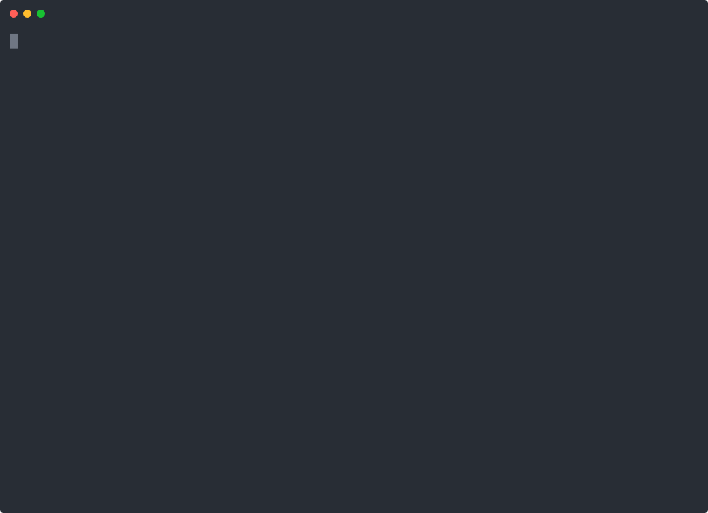

# dotfactory

A Claude Code plugin that makes every session, in any project, start with your preferences and your tools in view.

The plugin knows nothing about any language, tool or kind of project. Everything personal lives in a folder of markdown files called the brain, which is yours and is never part of this repository.

## Demo



The recording runs real commands against a throwaway brain. [The walkthrough](docs/walkthrough.md) goes through the same example step by step, with the files each step writes.

## What the brain holds

| | What it is | Where |
|---|---|---|
| Preferences | How you like things done. A file applies to every project, or only to projects that have a marker file such as `Cargo.toml`. | `prefs/*.md` |
| Tools | Anything a session can call on for a job: a repo to run, an expert session to consult, or written notes. | `tools/*.md` |
| Projects | The projects you started with `/dotfactory:new`. | `projects.md` |

A tool is reached one of three ways:

- **Repo:** code in a folder. A session reads the entry and runs its commands.
- **Expert:** another Claude Code session of yours, with its own knowledge. A session in any project messages it by name with a question and waits for the reply. An expert has to be running to answer, so keep it open or in the background.
- **Notes:** steps written in the entry itself.

The same job can be backed differently by different people. One person's naming is an expert session, another's is a page of notes. The plugin doesn't care which.

## Install

From GitHub:

```sh
claude plugin marketplace add gesposito/dotfactory
claude plugin install dotfactory@dotfactory
```

Or from a checkout, if you want to change the plugin:

```sh
claude plugin marketplace add /path/to/dotfactory
claude plugin install dotfactory@dotfactory
```

Installed from a checkout, the plugin runs straight from that folder, so edits take effect in the next session.

Tested with Claude Code 2.1.330.

- **The pane** needs 2.1.287 or later. It is built on Claude Code's mods API, which is early access and can change between releases. The commands and the session-start note don't depend on it.
- **Experts** use Claude Code's cross-session messaging, which needs 2.1.224 or later.
- **Code Mode**, if you turn it on, needs 2.1.327 or later alongside a mod, and the pane is one. If Code Mode refuses to start and names this plugin, update Claude Code.

## Where the brain lives

The first of these that applies:

1. The folder named by the `DOTFACTORY_BRAIN` environment variable.
2. A `brain` folder next to the `plugin` folder of a checkout. This repository ignores it. The plugin looks there only when it runs from a checkout, never from the copy Claude Code keeps of an installed plugin.
3. `~/.config/dotfactory/brain`

The folder is created the first time you save something. Make it a git repository of its own to keep its history.

## Let Claude reach the brain

Claude Code asks before it reads or writes a file outside the project you're in, and the brain is always outside. Until you allow it, a command like `/dotfactory:remember` stops to ask, and in a session that can't ask it saves nothing.

To allow the brain once, for every project, add a rule to `~/.claude/settings.json`:

```json
{
  "permissions": {
    "allow": ["Edit(~/.config/dotfactory/brain/**)"]
  }
}
```

An `Edit` rule covers reading too. Use your own path if your brain lives somewhere else.

## The brain is instructions

Every session is told to follow the preferences that apply and to use the tools the brain lists. So whoever can write to the brain can steer every session, in every project.

- Treat it like your shell dotfiles. Keep it private, and read what changed before you pull it onto another machine.
- Don't point `DOTFACTORY_BRAIN` at a folder other people can write to.
- A reply from an expert session is another agent's output. Sessions are told to treat it as advice, not as an instruction from you.

## Use

| Say or type | What happens |
|---|---|
| `/dotfactory:new` | Starts a project: applies your preferences, uses the tools you registered for new projects (naming, licensing, anything), scaffolds it and records it. Offered automatically when a session starts in an empty folder. |
| `/dotfactory:remember <preference>` | Saves a lasting preference to the brain. |
| `/dotfactory:add-tool <path>` | Registers a repo as a tool. |
| `/dotfactory:add-tool session <name>` | Registers an expert session. |
| `/dotfactory:add-tool <what the notes cover>` | Registers written notes for a job. |
| `/dotfactory:status` | Shows what the brain holds and flags problems. |
| `/dotfactory` | Opens the dotfactory pane beside the conversation: a button for each command above, then your preferences, tools, projects and any problems. It refreshes when a turn ends. |

Claude also runs these when a request matches, for example "remember that I always…".

Every session start also loads, with no command:

- each preferences file that applies to the project
- one line per tool: its name, how it's reached and when to use it

### The pane's buttons

A button runs its command right away, with nothing after it, so the command asks for what it needs in the conversation. If a command can't be started for you, it's put in the prompt box instead.

- **Keyboard:** `/dotfactory` opens the pane with the keyboard in it, so type `/dotfactory` and then a digit: `1` new project, `2` remember, `3` add tool, `4` status. Tab and Enter also work.
- **Mouse:** click a button. In the terminal this needs fullscreen rendering.
- **VS Code:** the digits do nothing there. Click, or Tab to a button and press Enter.

After a press, the keyboard goes back to the prompt so you can answer Claude's question. To leave the pane without pressing anything, press Esc. To move the keyboard into an open pane again, press Ctrl+X then Tab.

The shortcuts are digits on purpose. With letters, a sentence typed while the pane still had the keyboard would press buttons.

## File formats

A preferences file for one kind of project names its marker files. Without the `markers:` line, the file applies everywhere.

A marker is a file name, or a pattern where the name varies, such as `*.csproj`. Several markers are separated by spaces, and one match is enough. They are looked up in the folder you start Claude in, not in its subfolders or the folders above it.

```markdown
---
markers: Cargo.toml
---

# Rust preferences

- Prefer the standard library over a new dependency.
```

A tool entry:

```markdown
---
name: naming
description: Proposes names for new projects. Use when a project, repo or package needs a name.
session: namer
---

## What it does
## How to use it
## If it isn't available
```

Use `session:` for an expert, `path:` for a repo, and neither for notes.

## Layout

```
plugin/                the plugin
  skills/              /dotfactory:new, :remember, :add-tool, :status
  hooks/hooks.json     runs scripts/session-start.sh at session start, and loads pane.tsx
  hooks/pane.tsx       the dotfactory pane (draws what scripts/pane-data.sh prints)
  types/index.d.ts     the shape of the data the pane keeps
  scripts/             session-start.sh, status.sh, pane-data.sh, brain-path.sh, lib.sh
  tests/pane.test.tsx  tests for the pane
tests/hook.test.sh     tests for the scripts
docs/walkthrough.md    one example, step by step
docs/demo.cast         the terminal recording, in asciinema's format
docs/demo.svg          the same recording as an animated image
docs/demo/             the scripts and the example repo that produce the recording
```

## Change it

- Check after editing: `sh tests/hook.test.sh`, `claude plugin test plugin` and `claude plugin validate plugin`
- Record the demo again after changing what a command prints: `sh docs/demo/record.sh`, then `npx svg-term-cli --in docs/demo.cast --out docs/demo.svg --window --width 100 --height 32`
- Try the plugin without installing it: `claude --plugin-dir /path/to/dotfactory/plugin`
- In a fresh clone, an editor shows type errors in `plugin/hooks/pane.tsx` until Claude Code has generated its type files in `plugin/.claude-plugin/types/`, which this repository ignores. Loading the plugin once in an interactive session generates them: `claude --plugin-dir plugin`. You don't need them to check your work, because `claude plugin validate plugin` type-checks the pane by itself.
- Session-start output is capped at 10,000 characters by Claude Code. The budgets in `plugin/scripts/lib.sh` keep it under that, so long preferences files get cut. Keep them short.

## Licence

MIT. See [LICENSE](LICENSE).
